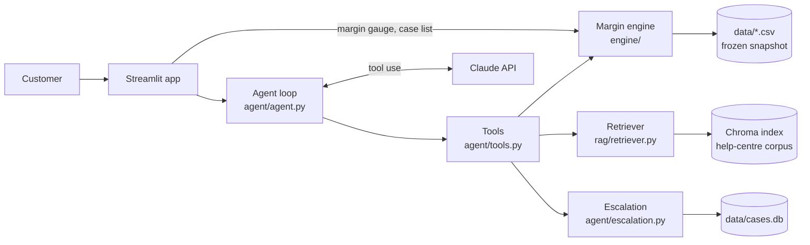

# moomoo SG Margin Risk Assistant

AI support agent that answers "Am I going to get liquidated?" for moomoo SG margin customers.
It prices positions, compares equity against the maintenance and soft-edge requirements, cites
help-centre rules, and escalates disputes and extension requests to a human risk desk. It never
gives buy/sell advice.

## Setup

```bash
python3 -m venv .venv && source .venv/bin/activate
pip install -r requirements.txt
cp .env.example .env        # add your ANTHROPIC_API_KEY
pytest                      # contract tests must stay green
streamlit run app/streamlit_app.py
python -m eval.run_eval     # calls the API: costs money (add question ids to run a few)
```

Use `python3.11` or newer, and activate `.venv` before running anything (`(.venv)` should show in
your prompt; Anaconda's `(base)` doesn't have the packages).

## Layout and owners

| Folder | Owner | What |
|---|---|---|
| `contracts.py` | all | **Frozen** data shapes between layers. Changes need a PR that both other teammates approve. |
| `data/`, `engine/` | A | Synthetic accounts, frozen price snapshot, margin ratios, margin engine, trading calendar |
| `notebooks/data_margin_engine/` | A | The notebook the engine was ported from. Run it from its own folder; it refreshes `data/stock_prices.csv`. `engine/` is the source of truth: the notebook still uses a x1.25 soft-edge uplift and has no 100% cap on drop distances. |
| `rag/`, `eval/` | B | Help-centre scrape, index, retriever; 30-question eval harness; README. Sources and their caveats: `docs/sources.md`. |
| `agent/`, `app/` | C | Claude tool-use loop, tools, escalation, Streamlit UI, deployment |

`engine/` runs on the CSVs in `data/`. Remaining `TODO(owner)` items still need finishing: keep the
signatures and keep `tests/test_contracts.py` passing.

`data/stock_prices.csv` is the frozen snapshot the demo runs on. Refreshing it changes the demo
numbers, and `tests/test_margin.py` will fail until its expected values are updated.

`get_prices(mode="live")` tries moomoo if `MOOMOO_ACCESS_TOKEN` is set, then yfinance, then the
snapshot. The agent's tools use the snapshot.

## Demo scenarios

Numbers are at the default demo clock (Fri 6 Nov 2026, 15:00 UTC) on the frozen price snapshot.

| # | Account | What the engine gives the agent |
|---|---|---|
| S1 | any | No account tools. |
| S2 | M-003 | Equity 1,137.40 vs maintenance 1,241.22 and soft edge 827.48. 173 hours below maintenance, so past the 48-hour clock. Use M-006 to show the clock still running (24 hours). |
| S3 | M-003 | NVDA -8%: equity 806.41. Above the normal soft edge (761.28), below the raised one (1,141.92). M-003 is also below the raised soft edge (1,241.22) before any price move. |
| S4 | M-003 | Escalation with a margin snapshot. |
| S5 | M-008 | Holds TSLA, which M-003 doesn't. Below soft edge, so the risk is `immediate`. |

## App features

| Feature | Where | What it answers in the brief |
|---|---|---|
| Chat agent with tool calls, citations and a tool trace | Main page | LLM agent, RAG with sources, transparency |
| Escalation with a structured case (snapshot, timeline, rule cited) | Chat, sidebar, **Risk desk** page | Escalate complex cases to humans with summarized histories |
| **Talk to a human** button | Sidebar | A fallback that doesn't depend on the model deciding to escalate |
| Number check on every answer | Under each answer | Hallucinations: flags any figure not in the engine's output |
| Margin gauge, with price age | Sidebar | Communicating the analytics outcome; data quality (prices are a 2 Nov snapshot) |
| What-if price sliders | Sidebar | Explore scenarios without the chatbot, straight from the engine |
| Weekend alert | Top of the page | Proactive warning when a raised pre-weekend soft edge would cause a breach |
| Risk desk page | Second page | The human agent's queue of escalated cases |

Everything except the chat runs from the engine, so it works without an API call.

## Architecture



The engine computes every number; Claude only explains them and must quote them exactly.
`eval/run_eval.py` checks that, along with tool choice, escalation, citations and refusals.

## Evaluation

`eval/questions.jsonl` has 30 questions: 10 concept, 10 account and what-if, 5 escalation and 5
advice requests. `python -m eval.run_eval` runs them through the agent and writes every answer to
`eval/results/<time>.jsonl` and a pass-rate table by category to `eval/results/<time>.md`. A
question passes only if the agent used the expected tools, escalated when it should, mentioned the
required words, avoided forbidden ones, cited the expected page, and every number in its answer
appears in a tool output or the question.

## Deployment (Streamlit Community Cloud)

Main file: `app/streamlit_app.py`. Put `ANTHROPIC_API_KEY` in the app's **Secrets** settings and
never commit it.
